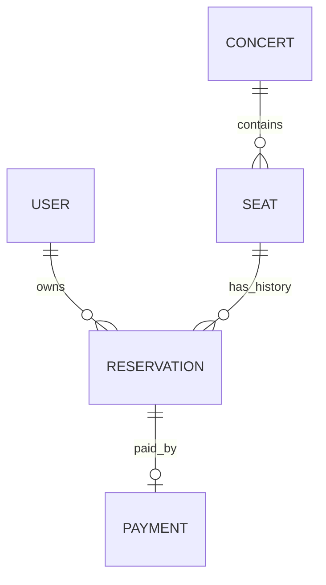
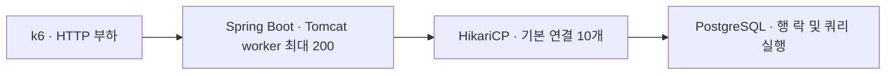

# Survive the Traffic

> 단일 Spring Boot 서버와 PostgreSQL 환경에서 좌석 예약의 정합성을 보장하고, HTTP 부하 테스트와 쿼리 분석으로 병목을 측정한 백엔드 프로젝트

**동일 좌석 예약 100건 중 1건 성공**, **예약 내역 조회 SQL 103개 → 2개**, **200 VU에서 오류율 3.52% 관측**. 기능 구현에서 시작해 동시성 제어, 부하 상황의 성능 검증까지 진행했다. 성능 수치는 2026-09-08 로컬 환경에서 조건별 1회 측정한 결과다.

## 1. Overview

공연 좌석을 5분간 선점하고 Mock 결제로 예매를 확정하는 서비스다. 핵심 과제는 **하나의 좌석에 활성 예약이 중복 생성되지 않게 하는 것**과 **정합성을 유지하는 과정에서 발생하는 대기 시간을 측정하는 것**이다.

| 단계 | 검증 질문 | 구현과 근거 |
|---|---|---|
| [Phase 1](Phase_1.md) | 한 요청의 상태 변경이 올바른가? | 예약·Mock 결제 API, 상태 전이, 트랜잭션 |
| [Phase 2](Phase_2.md) | 같은 좌석에 요청이 몰려도 예약은 하나인가? | 비관적 락, 낙관적 락 비교, DB 제약, PostgreSQL 통합 테스트 |
| [Phase 3](Phase_3.md) | 부하가 커지면 어디서 기다리는가? | k6, 커넥션·락 대기 관찰, 인덱스 분석, N+1 개선 |

실제 측정값과 해석은 [Phase 3 결과](Phase_3_Result.md), 원본 자료는 [load-tests/results](load-tests/results)에 정리했다. Phase 문서는 단계별 설계·학습 범위이며, 현재 구현과 검증 범위는 이 README와 결과 문서를 기준으로 확인할 수 있다.

## 2. Problem

좌석을 조회한 뒤 `AVAILABLE`이면 선점하는 로직에서는 여러 트랜잭션이 같은 상태를 읽고 모두 조건을 통과할 수 있다. 좌석의 최종 상태가 `HELD`여도 예약 행이 여러 개라면 정합성은 깨진다.

따라서 **좌석 하나당 `PENDING` 또는 `CONFIRMED` 예약은 최대 하나**라는 규칙을 기준으로 삼았다. `@Transactional`로 좌석 변경과 예약 생성을 묶고, 행 락으로 경쟁 요청의 순서를 제어하며, DB 제약으로 중복 저장을 막았다.

정합성을 확보한 뒤에는 대기 비용이 드러났다. 같은 행의 락을 기다리는 요청이 DB 연결을 점유하면 다른 요청은 연결을 얻기 위해 기다린다. 이 흐름을 실제 HTTP 부하와 DB 상태로 확인하고, 반복 쿼리를 줄이는 개선을 적용했다.

## 3. Tech Stack

| 구분 | 기술 | 역할 |
|---|---|---|
| 언어 | Java 21 | 애플리케이션 구현 |
| 서버 | Spring Boot 4.1.0, Spring MVC, Tomcat | HTTP API, 요청 처리 |
| 데이터 접근 | Spring Data JPA, Hibernate, HikariCP | 트랜잭션, 엔티티 조회, DB 연결 관리 |
| 데이터베이스 | PostgreSQL 17.10 | 측정 환경의 DB 버전, 행 락·partial unique index |
| 스키마 | Flyway | V1 스키마, V2 정합성 제약, V3 조회 인덱스 관리 |
| 테스트 | JUnit Jupiter 6.0.3, AssertJ, Spring Boot Test | 기능·동시성·SQL 수 검증 |
| 측정 | k6 2.2.0, Spring Boot Actuator, EXPLAIN ANALYZE | HTTP 지연·오류율, 커넥션 대기, 실행 계획 |
| 실행 | Gradle Wrapper, Docker Compose | 빌드 및 로컬 PostgreSQL 실행 |

테스트 버전은 Gradle `testRuntimeClasspath`에서 확인했다. 설계 문서의 JUnit 5 표기와 달리 현재 의존성은 JUnit Jupiter 6.0.3이다. Compose 이미지는 `postgres:17`을 사용하므로 새로 내려받는 이미지의 패치 버전은 측정 당시의 17.10과 다를 수 있다.

## 4. Domain Model



| 도메인 | 책임과 제약 |
|---|---|
| User | 예약 소유자 식별, 이메일 유일성 |
| Concert | 공연명·예매 오픈 시각·공연 시각 저장 |
| Seat | 좌석 위치·가격·상태 관리, 공연 내 좌석 위치 유일성, `@Version` |
| Reservation | 사용자와 좌석 연결, 예약 상태·5분 선점 만료 시각 관리 |
| Payment | Mock 결제 결과 저장, 예약당 결제 최대 1건 |

좌석은 예약 이력을 여러 개 가질 수 있지만, 활성 예약은 동시에 하나만 허용한다. 정상 흐름에서 좌석은 `AVAILABLE → HELD → SOLD`, 예약은 `PENDING → CONFIRMED`로 바뀐다. `EXPIRED`·`CANCELLED` 상태는 정의되어 있으나, 자동 만료 처리와 취소 API는 아직 구현하지 않았다.

## 5. Phase 1: Single Request Correctness

공연 조회부터 좌석 선점, Mock 결제, 사용자 예매 내역 조회까지 연결했다.

| Method | API | 기능 |
|---|---|---|
| GET | `/api/concerts` | 공연 목록 조회 |
| GET | `/api/concerts/{concertId}` | 공연 상세 조회 |
| GET | `/api/concerts/{concertId}/seats` | 공연의 좌석 조회 |
| POST | `/api/reservations` | `{ "userId": 1, "seatId": 1 }`로 좌석 선점 |
| POST | `/api/reservations/{reservationId}/payments` | Mock 결제 및 예약 확정 |
| GET | `/api/users/{userId}/reservations` | 사용자 예매 내역 조회 |

예약 트랜잭션은 좌석을 `HELD`로 변경하고 `PENDING` 예약을 생성한다. 결제 트랜잭션은 예약 상태와 만료 시각을 검사한 뒤 `SUCCESS` 결제 기록, `CONFIRMED` 예약, `SOLD` 좌석을 함께 저장한다. 이미 선점·판매된 좌석, 만료된 예약, 결제 가능한 상태가 아닌 예약은 업무 예외로 거절한다.

구현 근거: [ReservationService](src/main/java/com/survive_the_traffic/reservation/service/ReservationService.java), [Reservation](src/main/java/com/survive_the_traffic/reservation/domain/Reservation.java), [Seat](src/main/java/com/survive_the_traffic/seat/domain/Seat.java).

만료 시각이 지난 예약의 **결제 차단**은 구현되어 있다. 예약을 `EXPIRED`로 바꾸고 좌석을 `AVAILABLE`로 되돌리는 자동 해제는 다음 과제다. 결제는 내부 Mock 처리이며 실제 PG 연동은 없다.

## 6. Phase 2: Concurrent Request Correctness

같은 좌석에 100개의 예약 작업을 보내는 테스트로 동시성 문제를 재현하는 단계에서 시작했다. 초기 재현 코드는 `b0a7d84` 커밋에 남아 있으며, 현재 회귀 테스트는 개선 이후의 정합성을 검증한다.

`@Transactional`은 작업을 하나의 트랜잭션으로 묶지만, 기본 `READ COMMITTED`에서 다른 트랜잭션의 동일 데이터 조회를 직렬화하지 않는다. 두 요청이 모두 `AVAILABLE`을 읽는 Check-Then-Act 경쟁을 제어하려면 추가 전략이 필요했다.

| 전략 | 동작 | 판단과 비용 |
|---|---|---|
| 비관적 락 | `PESSIMISTIC_WRITE`로 좌석 행을 잠근 뒤 상태 검사 | 현재 예약 경로에 적용. 동일 좌석 경쟁을 순서대로 처리하지만 락 대기가 발생한다. |
| 낙관적 락 | `@Version` 값으로 갱신 충돌 감지 | 별도 테스트에서 같은 버전을 읽은 두 트랜잭션의 충돌을 검증. 충돌 후 실패 처리와 재시도 비용을 고려해야 한다. |
| DB 제약 | 활성 예약의 `seat_id` 중복 저장 거절 | 다른 저장 경로에서도 예약 중복을 차단. 이력 보존과 활성 예약 제한을 함께 만족한다. |

현재 예약 흐름은 다음과 같다. `Seat`의 `@Version` 필드도 유지되어 있다.

```text
요청 → 사용자 확인 → 좌석 행 락 획득 → AVAILABLE 확인
     → HELD 변경 + PENDING 예약 생성 → 커밋 및 락 해제

후속 요청 → 락 획득 후 HELD 확인 → 409 Conflict
```

[V2 마이그레이션](src/main/resources/db/migration/V2__add_active_reservation_constraint.sql)은 활성 예약에만 유일성을 적용한다.

```sql
CREATE UNIQUE INDEX uq_active_reservation_per_seat
    ON reservation (seat_id)
    WHERE status IN ('PENDING', 'CONFIRMED');
```

단순 `UNIQUE(seat_id)`는 만료·취소 이력까지 중복으로 판단해 후속 예약을 막는다. Partial unique index는 이력을 남길 수 있지만 상태 변경이 정확히 반영되어야 한다. `expiresAt`이 지나도 상태가 `PENDING`이면 여전히 활성 예약으로 취급하며, 인덱스 저장 공간과 쓰기 유지 비용도 발생한다.

[ReservationConcurrencyTest](src/test/java/com/survive_the_traffic/ReservationConcurrencyTest.java)는 성공 1건·좌석 선점 실패 99건과 DB의 `PENDING` 예약 1건을 검증한다. [ReservationConstraintTest](src/test/java/com/survive_the_traffic/ReservationConstraintTest.java)는 `PENDING`·`CONFIRMED` 중복 차단과 `EXPIRED` 이력 허용을 확인한다. [DatabaseLockTest](src/test/java/com/survive_the_traffic/DatabaseLockTest.java)는 락 타임아웃, 반대 순서 락의 교착, 동일 순서 획득 시 교착 회피를 검증한다.

## 7. Phase 3: Load Test & Bottleneck Analysis



좌석 조회는 VU와 Hikari 풀 크기를 바꾸며 비교하고, 예약 쓰기는 동일 좌석과 서로 다른 좌석을 구분했다. 외부 트랜잭션의 10초 락으로 대기를 재현했으며, `EXPLAIN ANALYZE`와 Hibernate statement 수로 조회 비용을 분석했다.

비교용 seed, Lazy Loading 기준 API, 실행 계획 API는 `performance` 프로필에서만 활성화된다. 사용자 예약 조회의 실제 API는 Fetch Join을 사용한다.

## 8. Key Technical Decisions

| 판단 | 이유 | 검증 범위 |
|---|---|---|
| 비관적 락과 DB 제약을 함께 사용 | 경쟁 요청의 상태 검사와 저장 데이터의 유일성을 각각 보호 | 서비스 동시성 테스트, 제약 테스트, HTTP 예약 결과 |
| 필요한 연관 데이터에 Fetch Join 적용 | 예약 DTO 변환 중 좌석·공연을 반복 조회하는 N+1 제거 | 같은 응답 내용과 SQL 103개 → 2개 검증 |
| Hikari 기본값 10 유지 | 5·10·20에서 일관된 지연 개선이 관측되지 않음 | 같은 공연·100 VU 비교. 최적 풀 크기를 확정한 것은 아님 |
| 기존 인덱스와 추가 인덱스를 구분 | 기존 복합 인덱스의 효과를 V3 성과로 과대평가하지 않기 위해 | 세션 전용 임시 테이블에서 단계별 실행 계획 비교 |
| PostgreSQL로 동시성 검증 | 실제 행 락·제약·교착 동작 확인 | 로컬 Docker DB 기반 통합 테스트 |
| Redis·Kafka 도입 전 현재 구조 측정 | 해결할 병목을 먼저 특정하기 위해 | 현재까지 캐시·분산락·대기열·메시지 브로커 미도입 |

Fetch Join은 `Reservation → Seat → Concert`를 한 쿼리로 가져온다. 사용자 존재 확인 1회가 별도로 있어 최종 SQL은 2개다. 같은 공연의 예약 100건에서는 기존 조회가 사용자 확인 1 + 예약 1 + 좌석 100 + 공연 1로 총 103개였다. 모든 관계를 EAGER로 바꾸지 않고 [예약 내역 조회 쿼리](src/main/java/com/survive_the_traffic/reservation/repository/ReservationRepository.java)에 필요한 연관만 지정했다.

## 9. Test & Performance Results

### 측정 조건

- **2026-09-08, 로컬 환경에서 조건별 1회 측정.** Apple M3·16 GiB 장비에서 k6, Spring Boot, Docker PostgreSQL이 자원을 공유했다.
- 좌석 조회는 같은 공연의 10,000석, 예약 내역 조회는 같은 사용자의 확정 예약 100건을 사용했다. 기준 코드는 V3 인덱스 적용 상태다.
- 조회는 think time 없는 30초 closed-model 부하다. VU는 동시 실행 주체이며 실제 활성 사용자 수와 동일하지 않다.
- 별도 JVM warm-up 없이 조회를 10 → 50 → 100 → 200 VU 순서로 실행했고, 풀 크기 변경 시 서버를 재시작했다. JIT·캐시·실행 순서의 영향이 포함된다.
- 지연과 요청 수는 `phase:load`로 seed 요청을 제외했다. RPS는 해당 Counter의 실행 전체 시간 기준 rate다. 예약은 총 100건의 burst이며 정확한 동시 도착이나 지속 처리 한계를 뜻하지 않는다.
- 오류율은 `http_req_failed`다. Hot Seat의 예상 업무 충돌인 409는 별도로 집계했다. p95/p99는 각각 관측 요청의 95%/99%가 해당 시간 이내에 완료됐다는 의미다.

### Seat GET: 부하 증가

Hikari 10 기준이며 시간 단위는 ms다.

| VU | RPS | Avg | p95 | p99 | 오류율 |
|---:|---:|---:|---:|---:|---:|
| 10 | 95.29 | 104.73 | 147.12 | 177.62 | 0% |
| 50 | 96.98 | 512.09 | 638.47 | 876.60 | 0% |
| 100 | 90.16 | 1093.32 | 1228.28 | 1300.69 | 0% |
| 200 | 79.38 | 2378.29 | 3337.80 | 4426.09 | 3.52% |

VU 증가에도 처리량은 약 80~97 RPS에 머물렀고 p95/p99는 크게 증가했다. 200 VU에서는 2,670건 중 94건이 connection reset으로 실패했다. **연결 리셋의 직접 원인은 미확정**이며 DB timeout이나 Tomcat worker 부족으로 단정하지 않는다.

Actuator 표본의 Hikari pending은 50 VU에서 37, 200 VU에서 189였다. **커넥션 획득 대기는 관측으로 확인**했고, ORM 로딩·10,000석 JSON 직렬화·전송·로컬 자원 경쟁은 추가 병목 후보다. 각 후보의 기여도는 아직 측정하지 않았다.

### Hikari 풀 크기 비교

같은 공연·100 VU 기준이며 시간 단위는 ms다.

| Hikari | RPS | Avg | p95 | p99 | 오류율 |
|---:|---:|---:|---:|---:|---:|
| 5 | 95.48 | 1029.81 | 1230.71 | 2008.84 | 0% |
| 10 | 90.16 | 1093.32 | 1228.28 | 1300.69 | 0% |
| 20 | 96.03 | 1028.86 | 1289.20 | 1846.79 | 0% |

Hikari 20은 10보다 RPS가 약 6.5% 높았지만 p99도 약 42% 높았다. 풀 크기를 늘릴수록 좋아지는 추세가 없어 기본값 10을 유지했다. 연결을 늘리면 DB에 동시에 진입하는 작업도 늘어나므로, 연결 수와 DB 처리 비용을 함께 봐야 한다.

### Hot Seat와 Lock Wait

| 시나리오 | 요청 결과 | p95 | p99 |
|---|---|---:|---:|
| 동일 좌석 100건 | 201 1건 + 409 99건 | 113.92ms | 117.33ms |
| 서로 다른 좌석 100건 | 201 100건 | 49.65ms | 49.93ms |
| 동일 좌석 + 외부 락 10초 | 201 1건 + 409 99건 | 9964.08ms | 9965.76ms |

일반 Hot Seat는 대부분 거절되고 분산 좌석은 모두 INSERT/UPDATE하므로 수행 작업량도 다르다. 두 지연의 차이 전체를 순수 락 대기 시간으로 해석하지 않았다.

외부 락 실험에서는 `transactionid` 대기 1개, `tuple` 대기 9개, Hikari 커넥션 대기 90개를 관측했다. **Lock Wait → 연결 10개 점유 → 나머지 요청 Connection Wait → HTTP 지연**의 흐름을 재현했다. API p99가 약 9.97초까지 증가했어도 예약은 1건만 성공했고, 30초 connection timeout은 발생하지 않았다.

근거: [락 재현 스크립트](load-tests/lock-wait.sh), [DB 대기 표본](load-tests/results/lock-waits.txt), [커넥션 대기 표본](load-tests/results/hikari-lock-pending.json).

### 인덱스 전후 실행 계획

좌석 130,878건을 세션 전용 임시 테이블에 복사하고 `ANALYZE`한 뒤 같은 공연의 10,000석을 조회했다. 각 단계에서 warm-up 1회 후 1회 측정했으며, 원본 테이블과 인덱스는 변경하지 않았다.

| 조건 | 실행 계획 | Execution Time |
|---|---|---:|
| 인덱스 없음 | Seq Scan | 7.437ms |
| Phase 2 복합 unique index | Bitmap Index Scan + Bitmap Heap Scan | 0.788ms |
| V3와 같은 `concert_id` 인덱스 추가 | Index Scan | 0.642ms |

Seq Scan은 전체 행을 검사한다. Bitmap Scan은 인덱스에서 찾은 행 위치를 모아 테이블 페이지를 읽고, Index Scan은 인덱스를 따라 해당 행을 읽는다. 작은 테이블이나 많은 행을 반환하는 조건에서는 Seq Scan도 합리적인 계획일 수 있다.

기존 `(concert_id, section, row_number, seat_number)` 인덱스 대비 추가 인덱스의 차이는 **0.146ms**였다. 7.437ms → 0.642ms 전체를 V3만의 효과로 볼 수 없으며 캐시 영향도 포함된다. HTTP 지연이 같은 비율로 줄었다는 결과도 아니다. [V3](src/main/resources/db/migration/V3__add_phase3_query_indexes.sql)의 `reservation.user_id`·`reservation.seat_id` 인덱스까지 효과를 모두 입증한 것은 아니다.

근거: [비교 SQL](load-tests/index-comparison.sql), [실행 계획 원본](load-tests/results/index-comparison.txt).

### N+1: 확인된 개선

같은 사용자·예약 100건·100 VU·Hikari 10으로 비교했다. 시간 단위는 ms다.

| 방식 | SQL 수 | RPS | Avg | p95 | p99 | 오류율 |
|---|---:|---:|---:|---:|---:|---:|
| Lazy Loading | 103 | 255.32 | 389.22 | 470.48 | 953.91 | 0% |
| Fetch Join | 2 | 2442.47 | 40.86 | 76.12 | 110.11 | 0% |

**SQL 103개 → 2개**, HTTP RPS 약 **9.57배**, p95 약 **83.8% 감소**, p99 약 **88.5% 감소**를 확인했다. [UserReservationQueryTest](src/test/java/com/survive_the_traffic/user/service/UserReservationQueryTest.java)는 각 조회를 별도 트랜잭션·영속성 컨텍스트에서 수행하고 응답 내용의 동일성과 SQL 수를 검증한다. SQL 감소는 회귀 테스트로 검증한 결과이며, HTTP 개선 배율은 이번 로컬 측정에 한정한다.

## 10. How to Run

### 서버와 테스트

Java 21, Docker Compose, k6가 필요하다. 아래 ID 추출과 락 실험에는 `curl`·`jq`·Bash도 사용한다. 프로젝트 루트에서 실행하며 기본 포트는 API `8080`, PostgreSQL `5432`다.

```bash
docker compose up -d
SPRING_PROFILES_ACTIVE=performance ./gradlew --no-daemon bootRun
```

Flyway가 스키마와 인덱스를 적용하고 Hibernate는 스키마를 검증한다. 로컬 DB 이름·사용자·비밀번호는 모두 `ticketing`이다. `performance` 프로필은 실험용 seed·비교 API와 Actuator `health,metrics`를 활성화한다. 기본 API만 실행하려면 `./gradlew --no-daemon bootRun`을 사용한다.

통합 테스트는 실행 중인 PostgreSQL에 데이터를 저장하므로 개발·실험용 DB를 사용한다. 부하 테스트와 기능 테스트는 자원 경쟁을 피하도록 따로 실행한다.

```bash
./gradlew --no-daemon clean test
```

### 좌석 조회와 예약 부하

서버가 실행된 상태에서 별도 터미널로 진행한다. Seed 호출마다 새 데이터가 추가되며, 반환된 ID를 변수에 담아 동일 데이터를 재사용한다.

```bash
concert_id=$(curl -fsS -X POST \
  'http://localhost:8080/api/performance/seed/seat-read?seatCount=10000' \
  | jq -er '.concertId')

CONCERT_ID="$concert_id" VUS=100 DURATION=30s \
  k6 run load-tests/k6/seat-get.js

VUS=100 ITERATIONS=100 k6 run load-tests/k6/hot-seat-reservation.js
VUS=100 ITERATIONS=100 k6 run load-tests/k6/distributed-seat-reservation.js
```

좌석 조회의 `VUS`를 10·50·100·200으로 바꿔 같은 `concert_id`에 순서대로 실행한다. 두 예약 스크립트는 실행마다 필요한 사용자와 좌석을 자동 생성한다. `USER_COUNT` 또는 `COUNT`를 지정한다면 `ITERATIONS` 이상이어야 한다.

### N+1 전후 비교

```bash
user_id=$(curl -fsS -X POST \
  'http://localhost:8080/api/performance/seed/user-reservations?reservationCount=100' \
  | jq -er '.userId')

USER_ID="$user_id" QUERY_MODE=lazy VUS=100 DURATION=30s \
  k6 run load-tests/k6/user-reservations.js

USER_ID="$user_id" VUS=100 DURATION=30s \
  k6 run load-tests/k6/user-reservations.js
```

`QUERY_MODE=lazy`는 `/api/performance/baseline/users/{userId}/reservations`, 기본 모드는 `/api/users/{userId}/reservations`를 호출한다.

### 풀 크기·락 대기·인덱스 실험

서버를 종료한 뒤 Hikari 크기만 변경해 재시작한다. 5·10·20 각각에서 같은 공연·100 VU로 좌석 조회를 실행한다.

```bash
HIKARI_MAX_POOL_SIZE=5 SPRING_PROFILES_ACTIVE=performance \
  ./gradlew --no-daemon bootRun
```

락 대기 실험은 Hikari 10으로 서버를 재시작한 뒤 실행한다. 로컬 `ticketing-postgres` 컨테이너를 사용하며 결과 파일을 `load-tests/results`에 기록한다.

```bash
bash load-tests/lock-wait.sh

curl -fsS \
  "http://localhost:8080/api/performance/explain/concerts/$concert_id/seats?analyze=true"

docker exec -i ticketing-postgres psql -U ticketing -d ticketing \
  -v concert_id="$concert_id" < load-tests/index-comparison.sql
```

인덱스 비교 SQL은 실행 시점의 전체 좌석 데이터를 복사한다. 위 seed만 생성한 새 DB는 기존 실측의 130,878건과 데이터 규모가 다르다. 전체 재현 조건과 결과 내보내기 명령은 [Phase_3_Result.md](Phase_3_Result.md)를 참고한다.

## 11. What I Learned

트랜잭션의 원자성, 경쟁 요청의 순서 제어, DB의 유일성 제약은 각각 확인해야 한다. 같은 좌석을 두 번 예약하지 못하게 했더라도 대기가 길어질 수 있어, 최종 DB 상태와 지연·오류율을 함께 검증해야 한다.

평균만으로는 느린 일부 요청을 놓칠 수 있다. 처리량과 p95/p99를 함께 보고, HTTP worker 대기·커넥션 대기·DB 락 대기를 구분해야 변경할 대상을 정할 수 있었다. 풀 증설은 채택하지 않았고, SQL 수와 응답 내용을 검증할 수 있는 Fetch Join 개선을 핵심 결과로 남겼다.

이 프로젝트는 **플랫폼 안정성·데이터 정합성 경험을 보여주는 프로젝트**이며 AI 모델이나 개인화 기능은 구현하지 않았다. 국민은행 AI·플랫폼개발 직무와 연결되는 지점은 동시 신청·승인·거래 요청에서 지켜야 할 데이터 규칙을 정의하고 검증하는 관점이다. AI·플랫폼 서비스에서도 개인화 기능과 함께 DB 정합성, 응답 지연, 장애 가능성을 관리하는 기반이 중요하다고 보았다.

## 12. Limitations & Next Steps

| 현재 한계 | 다음 검증 또는 구현 |
|---|---|
| 만료 후 `PENDING`·`HELD`가 자동 해제되지 않음 | 만료 상태 전이와 좌석 반환을 원자적으로 처리하고 결제와의 경쟁 검증 |
| 인증·권한·실제 PG·취소 API 미구현 | 사용자 소유권 검증, 결제 멱등성, 외부 결제 실패·복구 설계 |
| 200 VU 연결 리셋의 직접 원인 미확정 | 서버·클라이언트 로그, CPU·GC·직렬화 시간과 Tomcat 대기를 함께 수집 |
| 로컬 장비 공유·조건별 1회 측정 | 부하 발생기 분리, warm-up·반복 실행·실행 순서 통제로 변동성 확인 |
| 조회에서 전체 좌석·예약 목록 반환 | 페이지네이션과 DTO projection의 응답 크기·SQL·지연 비교 |
| 개발 DB에 의존하는 통합 테스트 | Testcontainers 등으로 테스트 DB 격리 및 CI 재현성 확보 |

Redis 캐시는 반복 조회 비용이 병목으로 확인될 때 검토하되 좌석 상태의 최신성 정책이 필요하다. 대기열·요청 제한은 DB 진입량 제어가 필요할 때, Kafka는 예약 이후 작업의 비동기 분리가 필요할 때 검토한다. Redis 분산락, 대기열, Kafka, 서버 확장은 현재 미도입 상태이며 각각 해결할 문제와 추가 정합성 비용을 검증한 뒤 판단할 예정이다.

### 최종 검증 기록

2026-09-08 기준 코드와 [Phase 3 결과 기록](Phase_3_Result.md)에 대한 검증이다.

- `./gradlew --no-daemon clean test` 통과: **테스트 41개, 실패·오류·건너뜀 0개**.
- k6 스크립트 4개 `k6 inspect` 통과.
- 락 재현 스크립트 `bash -n load-tests/lock-wait.sh` 통과.
- 200 VU 부하의 threshold 실패는 성능 한계 관측 결과로 보존.
- 운영 SLA 충족, 운영 용량 확정, 모든 병목 해결을 입증한 결과는 아니다.
