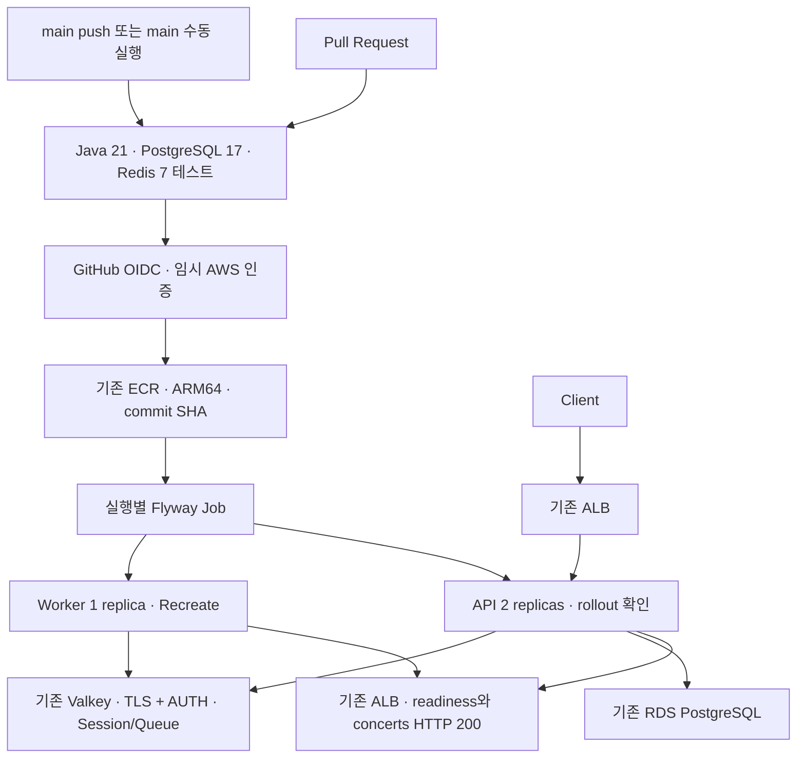

# 백엔드 AWS 배포 운영 문서

2026-10-22 기존 인프라를 조회한 뒤 구성했다. EKS/RDS/Valkey/ECR/ALB/VPC를 재생성하지 않는다.



## 현재 리소스와 소유 범위

| 항목 | 값 / 관리 방법 |
|---|---|
| AWS region | `ap-northeast-2` |
| EKS | `survive-traffic`, ARM64 노드, Kubernetes 1.37 |
| ECR | `248189924429.dkr.ecr.ap-northeast-2.amazonaws.com/survive-the-traffic`, IMMUTABLE |
| Namespace | 기존 `ticketing` |
| API / Worker | `ticketing-api` 2개 / `ticketing-queue-worker` 1개 |
| 설정 | 기존 `ticketing-config`를 운영자가 관리 |
| DB Secret | 기존 `ticketing-secret`: `DB_USERNAME`, `DB_PASSWORD` |
| Valkey Secret | 기존 `ticketing-valkey-secret`: `REDIS_PASSWORD` |
| 배포 Role | `arn:aws:iam::248189924429:role/ticketing-github-actions` |

운영 ConfigMap에는 기존 `DB_HOST`, `DB_PORT`, `DB_NAME`, `REDIS_HOST` 등이 있어야 한다.
실제 DB/Valkey endpoint 및 비밀번호는 이 저장소에 기록하지 않는다.
배포 overlay는 ConfigMap/Secret/Namespace/DB/캐시를 생성하거나 덮어쓰지 않는다.

## Kustomize 구조

```text
k8s/
  base/                 API, Worker, Service와 공통 kustomization
    migration-job.yaml  별도 실행 템플릿; 일반 apply 대상에서 제외
  local-infra/          로컬 PostgreSQL, Redis, ConfigMap
  overlays/local/       base + local-infra (ALB 없음)
  overlays/prod/        base + 기존 ALB Ingress + Valkey TLS/Secret 주입
  access/               관리자용 namespace Role/RoleBinding; 일반 배포에서 제외
  aws/cluster.yaml      기존 구축 자료; 이 배포 작업에서는 실행하지 않음
```

운영 이미지 선택은 `scripts/deployment/render.sh`가 임시 Kustomization으로 처리한다.
Git의 YAML을 직접 수정하지 않는다. **운영에서 overlay를 이미지 지정 없이 직접 apply하지 않는다.**
base의 `survive-the-traffic:local`은 로컬 이미지이며 운영 배포에는 ECR의 명시적 tag가 필요하다.

| 역할 | APP_ROLE | Worker enabled | Flyway enabled |
|---|---|---|---|
| API | api | false | false |
| Worker | worker | true | false |
| Migration | migration | 기본 false | true |

운영 API/Worker는 `REDIS_PORT=6379`, `REDIS_SSL_ENABLED=true`를 명시한다.
Worker는 HTTP 서버가 없는 별도 애플리케이션이며, 중복 Worker 실행을 막기 위해 `Recreate`를 유지한다.
rollout 뒤 pod의 Ready와 재시작 횟수도 검사하지만, 실제 admission 동작은 Queue smoke로 확인한다.

## CI / CD

- `backend-ci.yml`: PR에서 실행하고 다른 workflow에서 재사용한다. Java 21, Gradle wrapper/cache,
  runner 내부 PostgreSQL/Redis로 `clean test bootJar`를 수행한다. manifest 렌더링과 배포 실패 차단 테스트도 수행한다.
- `backend-deploy.yml`: `main` push와 `main` 수동 실행에서 먼저 같은 CI를 호출한다.
  CI 성공 후에만 OIDC 권한을 받으므로 `main`에서도 동일한 테스트가 실행된다.
  workflow를 분리하되 테스트 실행은 중복하지 않는다.
- 배포는 concurrency group 하나로 직렬화하고 진행 중인 배포를 새 push로 취소하지 않는다.
- 외부 Actions는 공식 저장소의 release commit SHA로 고정했다.
- Java bytecode는 빌드 호스트에서 생성하고 runtime 이미지는 `linux/arm64`로 빌드한다.
- ECR tag는 전체 40자리 commit SHA다. IMMUTABLE 정책을 유지하며 `main`/`latest`를 덮어쓰지 않는다.
  같은 SHA의 이미지를 이미 push했다면 재실행에서 재사용한다.

CI에서 사용하는 `ticketing` DB 비밀번호는 runner 내부 일회용 테스트 서비스용 값이다.
실제 AWS 인증 정보, 운영 DB 비밀번호, 테스트 사용자 비밀번호를 workflow에 기록하지 않는다.

기존 MockHttpSession 통합 테스트는 서블릿 세션 범위를 명시했다.
`RedisSessionIntegrationTest`는 실제 HTTP 쿠키와 Redis 저장소를 사용해 로그인 후 세션 ID 변경,
이전 세션 거부, 다음 요청의 인증 복원, CSRF 없는 로그아웃 거부, 정상 로그아웃을 검증한다.

## GitHub repository 설정

Repository Settings → Secrets and variables → Actions → Variables:

| Variable | 값 |
|---|---|
| `AWS_REGION` | `ap-northeast-2` |
| `AWS_ROLE_ARN` | 위 배포 Role ARN |
| `EKS_CLUSTER_NAME` | `survive-traffic` |
| `ECR_REPOSITORY_URI` | 위 기존 ECR URI |

기본 배포에 필요한 GitHub Secret은 없다. `AWS_ACCESS_KEY_ID`/`AWS_SECRET_ACCESS_KEY`를 등록하지 않는다.
Queue smoke를 수동 실행할 때만 기존 테스트 계정의 `TEST_EMAIL`, `TEST_PASSWORD`,
테스트 가능한 `CONCERT_ID`를 로컬 환경변수로 전달한다. 공유 CI로 확장하면 테스트 계정 값은 Actions Secret으로 관리한다.

## OIDC / 최소 권한

기존 EKS용 OIDC Provider는 GitHub용과 발급자가 다르므로 별도 GitHub Provider를 추가했다.
배포 Role의 trust는 audience `sts.amazonaws.com`,
subject `repo:gimogibumo/survive_the_traffic:ref:refs/heads/main`으로 제한한다.
PR/다른 branch는 Role을 assume할 수 없다. 이 workflow에 GitHub environment를 추가하면
OIDC subject 형식이 달라지므로 trust 정책과 함께 검토해야 한다.

정책 원본:

- [OIDC trust](github-oidc-trust.json)
- [AWS 권한](github-aws-policy.json): 기존 ECR의 push/read, 해당 EKS의 DescribeCluster만 허용.
  `ecr:GetAuthorizationToken`만 AWS 요구에 따라 Resource `*`를 사용한다.
- [Kubernetes Role](../../k8s/access/github-deployer.yaml): 기존 두 Deployment, API Service/Ingress를
  조회·수정하고 migration Job을 생성·조회한다. Secret 직접 조회, 다른 namespace, 인프라 관리 권한은 없다.

Job 생성과 Deployment 수정 권한은 해당 namespace의 Secret을 사용하는 workload를 실행할 수 있는 권한이다.
따라서 Role은 신뢰하는 배포 workflow에만 연결한다. namespace RBAC는 workload 내부에서의 Secret 사용까지 차단하지 않는다.

동일 설정을 복구할 때 관리자가 먼저 존재 여부를 확인하고 필요한 항목만 실행한다:

```bash
aws iam list-open-id-connect-providers
aws iam get-role --role-name ticketing-github-actions
aws eks list-access-entries --cluster-name survive-traffic

# GitHub Provider가 없는 경우에만
aws iam create-open-id-connect-provider \
  --url https://token.actions.githubusercontent.com \
  --client-id-list sts.amazonaws.com

# Role이 없는 경우에만
aws iam create-role --role-name ticketing-github-actions \
  --assume-role-policy-document file://docs/deployment/github-oidc-trust.json
aws iam put-role-policy --role-name ticketing-github-actions \
  --policy-name ticketing-ecr-eks-deploy \
  --policy-document file://docs/deployment/github-aws-policy.json

# 해당 access entry가 없는 경우에만; Role 생성 직후 IAM 전파에 시간이 걸릴 수 있음
aws eks create-access-entry --cluster-name survive-traffic \
  --principal-arn arn:aws:iam::248189924429:role/ticketing-github-actions \
  --type STANDARD --kubernetes-groups ticketing:github-deployer
kubectl apply -f k8s/access/github-deployer.yaml
```

일상 배포 Role에는 위 관리자 설정 권한을 부여하지 않는다.
기존 EKS의 endpoint 접근 정책과 VPC/보안 그룹은 변경하지 않았다.

## 자동 배포

테스트를 통과한 변경을 `main`에 push하거나 Actions → Backend Deploy → Run workflow에서 `main`을 선택한다.
checkout한 SHA로 테스트와 이미지를 묶고 기존 ECR에 push한다.
EKS kubeconfig는 runner 임시 디렉터리에만 생성한다.

`deploy.sh`는 다음 순서를 강제한다:

1. 이미지 tag와 입력 검증 → 운영 manifest 렌더링 → 서버 dry-run.
2. API/Worker의 이전 이미지 URI를 로그에 남긴다.
3. `ticketing-migration-<SHA 앞부분>-<run ID>-<attempt>` Job을 생성한다.
4. Migration 완료를 기다린다. 실패/timeout이면 애플리케이션 apply를 실행하지 않는다.
5. API/Worker/Service/Ingress를 apply하고 두 Deployment rollout을 기다린다.
6. Worker pod 상태를 추가 확인하고 ALB HTTP smoke를 수행한다.

Job은 재실행마다 이름이 다르므로 기존 완료 Job을 삭제하거나 재생성하지 않는다.
새 Job만 24시간 TTL로 정리하며 실행 제한은 300초, 재시도는 0회다.
Flyway는 이미 적용된 migration을 건너뛴다. 실패한 migration을 자동 repair하지 않는다.

## 수동 배포 / 사전 검증

저장소 루트에서 실행한다. AWS 인증과 기존 클러스터 접근 권한이 필요하다.

```bash
bash scripts/deployment/install-kubectl.sh /tmp/ticketing-tools
export PATH="/tmp/ticketing-tools:$PATH"
export AWS_REGION=ap-northeast-2
export ECR_REPOSITORY_URI=248189924429.dkr.ecr.ap-northeast-2.amazonaws.com/survive-the-traffic
aws eks update-kubeconfig --name survive-traffic --region "$AWS_REGION"
kubectl config current-context

# 이미지가 기존 ECR에 있는지 확인
release_sha=$(git rev-parse HEAD)
aws ecr describe-images --repository-name survive-the-traffic \
  --image-ids "imageTag=$release_sha" --query 'imageDetails[].imageDigest'

# 운영 변경 없이 검증
bash scripts/deployment/render.sh "$ECR_REPOSITORY_URI:$release_sha" \
  | kubectl apply --dry-run=server -f -

# SHA 이미지가 push된 경우에만 실제 배포
bash scripts/deployment/deploy.sh deploy \
  "$ECR_REPOSITORY_URI:$release_sha" "manual-$(date +%Y%m%d%H%M%S)"
```

로컬 Kubernetes는 먼저 로컬 context인지 확인한 뒤 namespace와 개발용 DB Secret을 별도로 준비하고
`kubectl apply -k k8s/overlays/local`을 실행한다. 로컬 overlay는 운영용 TLS/Valkey Secret을 요구하지 않는다.
CI 통합 테스트에는 Kubernetes 대신 runner 내부 서비스 컨테이너를 사용한다.

## Rollback

실패 직전 workflow의 `Previous ticketing-api image`와 `Previous ticketing-queue-worker image`를 확인한다.
배포 전 두 역할이 같은 릴리스였음을 확인하고 그 이미지 URI를 사용한다.
초기 이전 버전은 기존 `phase8-valkey-20261022-145858` tag이며 이후에는 전체 SHA tag다.

```bash
export ECR_REPOSITORY_URI=248189924429.dkr.ecr.ap-northeast-2.amazonaws.com/survive-the-traffic
previous_tag='<이전 전체 SHA 또는 기존 phase8 tag>'

# 이미지를 다시 빌드하거나 migration을 실행하지 않는다.
bash scripts/deployment/deploy.sh rollback \
  "$ECR_REPOSITORY_URI:$previous_tag" "rollback-$(date +%Y%m%d%H%M%S)"
```

rollback도 서버 dry-run, 두 역할의 rollout, Worker 상태, readiness/concerts HTTP 200을 검사한다.
롤백 전 migration과 이전 코드의 스키마 호환성을 확인한다. DB schema/data는 역변환하지 않는다.
일부 rollout 후 실패했더라도 자동 `rollout undo`는 실행하지 않으며 운영자가 위 명시적 이미지로 복구한다.
API/Worker의 이전 이미지가 서로 다른 경우 각 역할의 호환 릴리스를 먼저 결정해야 한다.

## Smoke test / Secret 처리

```bash
bash scripts/deployment/smoke.sh

# 기존 테스트 계정 값은 shell에서 안전하게 읽거나 Secret 저장소에서 환경변수로 주입한다.
# 명령행에 비밀번호를 직접 적지 않는다.
k6 run load-tests/k6/queue-auth-smoke.js
```

HTTP smoke는 Ingress status에서 ALB hostname을 찾고 readiness와 concerts가 모두 HTTP 200인지 확인한다.
curl response body, credential, cookie는 출력하지 않는다.
Queue smoke에는 `BASE_URL`, `TEST_EMAIL`, `TEST_PASSWORD`, 선택적 `CONCERT_ID` 환경변수가 필요하다.
CSRF → login → 새 CSRF → join → ADMITTED → logout 순서이며 check/timeout 실패는 k6 비정상 종료로 처리한다.
즉시 ADMITTED가 되면 WAITING 응답은 관측하지 못할 수 있다.

Secret은 기존 Kubernetes Secret 참조로 주입한다. `.env`, `.aws`, `.kube`, private key 파일은
Git/Docker context에서 제외한다. Secret YAML이나 `kubectl get secret -o yaml`을 로그로 출력하지 않는다.
인증정보를 workflow artifact나 GitHub variable에 넣지 않는다.

## Troubleshooting

| 증상 | 확인 사항 |
|---|---|
| OIDC AssumeRole 실패 | repo/branch, `id-token: write`, audience/subject, IAM 전파. JWT 자체는 출력하지 않음 |
| EKS Forbidden | Role access entry의 group과 RoleBinding, namespace, 리소스 이름별 verbs |
| ECR tag 충돌 | IMMUTABLE 유지. 같은 SHA면 기존 이미지 재사용, 다른 소스는 새 commit으로 배포 |
| ImagePullBackOff / exec format error | 기존 ECR URI, SHA 존재, `linux/arm64` manifest와 노드 IAM pull 권한 |
| Migration 실패 | Job 상태와 Flyway/RDS 연결을 운영자가 확인. Secret을 출력하지 않고 원인 수정 후 새 attempt 실행 |
| rollout timeout | pod 상태/이벤트, 메모리·노드 여유, 기존 Secret/ConfigMap. 실패 상태에서 다음 단계 실행 금지 |
| Valkey 연결 실패 | 기존 endpoint, 6379, TLS true, Secret 키 이름, 기존 SG 접근. 접근 범위를 임의 확장하지 않음 |
| Queue smoke 실패 | 테스트 사용자, CSRF 재발급, Redis Session, Worker 상태, 실제 공연 ID |
| HTTP smoke 실패 | ALB target 상태, API readiness, RDS 연결, Ingress hostname과 HTTP status |

## 검증 범위

구현 중 로컬 `clean test`: 127개, 실패/오류 0개, 기존 skip 1개.
세션 통합 테스트 보정 후 검증한 수치다. 배포 실패 차단 테스트 5개, actionlint, 두 overlay 렌더링,
EKS 서버 dry-run도 검증했다. 실제 배포 성공 여부는 해당 SHA의 GitHub Actions run과
두 Deployment 이미지/rollout, ALB smoke 결과를 함께 확인한다.
이 문서는 운영 용량이나 SLA를 입증하지 않는다.

설정 근거: [GitHub OIDC 공식 문서](https://docs.github.com/en/actions/how-tos/secure-your-work/security-harden-deployments/oidc-in-aws),
[EKS access entry 공식 문서](https://docs.aws.amazon.com/eks/latest/userguide/creating-access-entries.html),
[Spring Boot auto-configuration 공식 문서](https://docs.spring.io/spring-boot/reference/using/auto-configuration.html).
